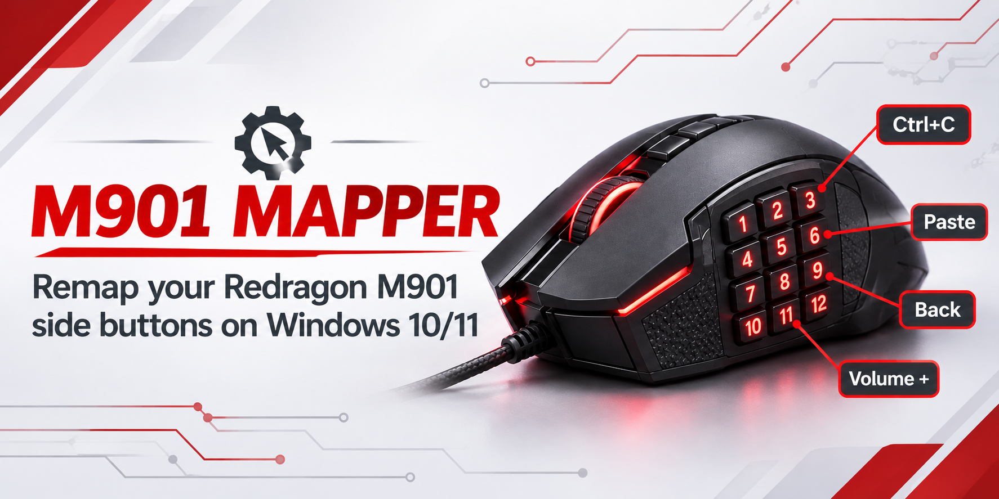

# M901 Mapper



Remap the side buttons of the **Redragon M901 Perdition** (original laser model, USB ID `04D9:FC02`) on Windows 10 and 11.

## Background

Redragon's currently available "Perdition" software (released 2018) only supports the later Perdition models
(USB ID `04D9:FC40`). The original M901 does not understand its commands, so the software cannot configure it, and the
original 2013 software is no longer available for download.

The M901 still sends whatever its buttons were programmed with, such as `Ctrl+C`, `Ctrl+V`, number keys, or mouse
Back/Forward. **M901 Mapper** intercepts input from the M901 only and replaces each button's output with the action you
choose. Other keyboards and mice, as well as the M901's left, right and middle buttons, are not affected.

## Features

- **Detect button**: press any side button to identify it, no guesswork.
- **Action picker** grouped by category: editing (copy, paste, undo...), mouse buttons, browser, media and volume,
  single keys, Windows shortcuts, or custom (any key combination, typing text, launching a program or website).
- **Mapping ON/OFF** switch to temporarily restore the mouse's original behaviour.
- **Backup and Restore** of all button settings.
- **Start with Windows**, running in the system tray.

## Installation

### Step 1 – Install the Interception driver (required, one time)

M901 Mapper relies on the [Interception](https://github.com/oblitum/Interception) driver to tell the M901 apart from
other input devices. This is required for both the EXE and the script version. Administrator rights are needed.

1. Download `Interception.zip` from <https://github.com/oblitum/Interception/releases> and extract it.
2. Open **Command Prompt as Administrator** and run:
   ```
   "<extracted folder>\Interception\command line installer\install-interception.exe" /install
   ```
   In PowerShell, add `&` before the quoted path.
3. Restart Windows.

To uninstall the driver, run the same command with `/uninstall` and restart.

### Step 2 – Run M901 Mapper

#### Option A: Download the EXE (recommended)

1. Download **`M901Mapper.exe`** from the [latest release](https://github.com/Suleiman700/Reddragon-mouse-profiler/releases/latest).
2. Place it in a folder of its own (for example `C:\Tools\M901Mapper\`) and run it.

AutoHotInterception and the Interception library are bundled in the EXE. On first launch it creates a `Lib` folder next
to itself; keep it there.

#### Option B: Run the AutoHotkey script

For users who want to read or modify the source.

1. Install [AutoHotkey v2](https://www.autohotkey.com/).
2. Clone or download this repository.
3. Download [AutoHotInterception](https://github.com/evilC/AutoHotInterception/releases) and extract it.
   Copy the contents of its `AHK v2\Lib` folder, plus `AHK v2\AutoHotInterception.dll`, into a `Lib` folder in this
   repository.
4. Copy the `library\x64` and `library\x86` folders from `Interception.zip` (Step 1) into `Lib`.
5. Unblock the downloaded DLLs: run `Lib\Unblocker.ps1` as Administrator, or right-click each `.dll` →
   Properties → tick **Unblock**.
6. Run `M901Mapper.ahk`.

Expected layout:
```
M901Mapper.ahk
Lib\AutoHotInterception.ahk
Lib\AutoHotInterception.dll
Lib\CLR.ahk
Lib\x64\interception.dll
Lib\x86\interception.dll
```

#### Building the EXE

Download Ahk2Exe from <https://github.com/AutoHotkey/Ahk2Exe/releases>, then run in Git Bash:
```
bash build.sh <path-to-Ahk2Exe.exe>
```
The output is `dist\M901Mapper.exe`.

## Usage

1. Start M901 Mapper.
2. Click **Detect button** and press a side button on the mouse.
3. Choose an action from the list, then click **OK**.
4. Repeat for the other buttons.

Buttons that are not set up keep their original function. Settings are saved automatically to `M901Mapper.ini` next to
the program. Closing the window keeps the mapping active in the system tray; to quit, right-click the tray icon and
choose **Exit**.

| Control | Purpose |
|---|---|
| **Change action** | Pick a new action for the selected button (or double-click it). |
| **Rename** | Give the selected button a friendly name, e.g. "Side 5". |
| **Unchanged** | Keep the button listed but restore its original function. |
| **Remove** | Remove the button from the list. |
| **Mapping: ON/OFF** | Pause or resume all remapping (also available in the tray menu). |
| **Backup** | Save all button settings to an `.ini` file. |
| **Restore** | Load settings from a backup. The current settings are kept as `M901Mapper.ini.bak`. |
| **Start with Windows** | Launch M901 Mapper hidden in the tray at sign-in. |

## Limitations

- Remapping happens in Windows, not in the mouse. It only applies on computers where M901 Mapper (and the Interception
  driver) is installed and running.
- DPI, polling rate and lighting are stored in the mouse's firmware and cannot be changed.
- Buttons handled internally by the mouse (such as DPI buttons) send nothing to Windows and cannot be remapped.
- Only the Redragon M901 Perdition with USB ID `04D9:FC02` is supported.

## Troubleshooting

| Problem | Solution |
|---|---|
| "Could not get keyboard with VID 1241, PID 64514" on start | The Interception driver is not installed or not active yet. Complete Step 1 and restart Windows. Also check that the M901 is plugged in. |
| "`#Include` file `Lib\AutoHotInterception.ahk` cannot be opened" | The script version is missing its `Lib` folder. Follow Option B, steps 3–5. |
| A DLL "failed to load" | The DLLs are blocked by Windows. Unblock them (Option B, step 5). |
| Detect button does not react | Make sure only one copy of M901 Mapper is running, then unplug and re-plug the mouse. |

## Credits

- [AutoHotkey](https://www.autohotkey.com/)
- [AutoHotInterception](https://github.com/evilC/AutoHotInterception) by evilC
- [Interception](https://github.com/oblitum/Interception) by Francisco Lopes da Silva

Refer to each project for its license terms.

This project is not affiliated with or endorsed by Redragon.
